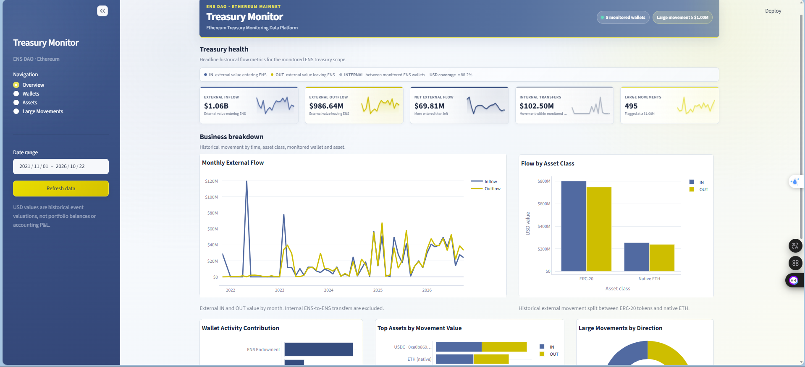
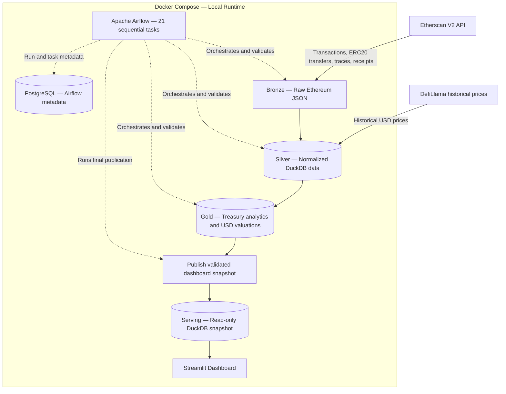

# Ethereum Treasury Monitoring Data Platform

A Docker-based batch data platform for monitoring **historical treasury movements across five ENS DAO wallets on Ethereum**.

The system ingests on-chain activity, normalizes and validates it, enriches eligible asset movements with historical USD prices, and exposes organization-level and wallet-level analytics in a Streamlit dashboard. Apache Airflow orchestrates the end-to-end workflow.

> **Scope:** This project tracks **historical capital flows and activity**, not current wallet balances, portfolio profit and loss, or formal financial statements.

## Dashboard Preview



*Overview of historical inflows and outflows, internal transfers, large movements, and asset-level activity. Values shown in the screenshot are a point-in-time snapshot and will change as new data is ingested.*

The dashboard contains four views:

- **Overview:** External inflows, external outflows, net flows, internal transfers, and trends.
- **Wallets:** Activity across the five monitored ENS DAO wallets.
- **Assets:** Historical movement value by asset and asset class.
- **Large Movements:** Significant historical ETH and ERC20 movements, using a configurable USD threshold.

## System Architecture



**Key design decisions**

- **Bronze:** Raw Etherscan responses stored as JSON under `data/raw/ethereum/`.
- **Silver:** Cleaned Ethereum activity, wallet metadata, and historical prices in DuckDB.
- **Gold:** Analytical tables for wallet/organization flows, counterparties, historical USD valuations, and large movements.
- **Serving:** A separate, validated DuckDB snapshot for Streamlit; the dashboard does not read the actively updated analytical database directly.
- **Airflow:** Workflow orchestration, dependencies, run history, and failure visibility. PostgreSQL stores Airflow metadata **only**, not treasury analytics.

### Technology Stack

| Component | Technology |
| --- | --- |
| Blockchain source | Etherscan V2 API (Ethereum mainnet) |
| Historical USD price source | DefiLlama |
| Processing | Python, Pandas |
| Analytical storage | DuckDB |
| Workflow orchestration | Apache Airflow 3.3.2 (LocalExecutor) |
| Orchestration metadata | PostgreSQL 16 |
| Dashboard | Streamlit, Plotly |
| Runtime | Docker, Docker Compose |

## Monitoring Scope

The V1 configuration monitors five ENS DAO-related wallets, defined in [`config/wallets.json`](config/wallets.json):

| Wallet ID | Wallet |
| --- | --- |
| `dao_timelock` | DAO Wallet / Timelock |
| `endowment` | ENS Endowment |
| `metagov_main` | Meta-Governance Main Multisig |
| `ecosystem_main` | Ecosystem Main Multisig |
| `public_goods_main` | Public Goods Main Multisig |

The project distinguishes external transfers from transfers **between monitored ENS wallets**. At the organization level, monitored-to-monitored movements are classified as internal and should not be counted as external capital inflows or outflows.

## Data Processing and Business Rules

- **Incremental ingestion:** Each monitored wallet and Etherscan dataset has a block checkpoint. API pagination starts again at page 1 for the **new block range**; it does not imply a full historical reload.
- **ERC20 events:** Token transfers are identified from `Transfer` event logs. The blockchain event key uses chain ID, transaction hash, and log index. A single outer transaction can produce multiple transfer events.
- **Native ETH versus tokens:** Native ETH movements are modeled separately from ERC20 token transfers; WETH is **not** the same asset as native ETH.
- **Internal execution:** Internal traces are part of transaction execution, not separate user-signed transactions. Normal transactions, internal ETH movements, and ERC20 event logs must not be naively added together.
- **Valuation:** Supported assets are valued using historical USD prices. Missing or out-of-scope pricing remains explicitly unavailable (`NULL`), **never $0 by assumption**.
- **Large movements:** The default threshold is **USD 1,000,000**, configured in [`config/monitoring.json`](config/monitoring.json). It is a project monitoring rule, **not an official ENS DAO policy**.
- **Gas attribution:** The sender of an outer Ethereum transaction normally pays its network fee, but that alone does not prove which treasury wallet economically bore the cost.

## Airflow Workflow

The DAG is defined in [`dags/ens_treasury_pipeline_v1.py`](dags/ens_treasury_pipeline_v1.py).

- **DAG ID:** `ens_treasury_pipeline_v1`
- **Tasks:** 21 sequential tasks, including the final dashboard-snapshot publication task.
- **Schedule:** Daily at **03:00, Asia/Ho_Chi_Minh**, when the DAG is unpaused and the Docker host is running.
- **Concurrency:** One active DAG run and one active task at a time to serialize writes to the shared DuckDB file.
- **Retry policy:** V1 currently uses zero automatic task retries; failures are investigated before rerunning.

<escape><details>
<summary>View all 21 tasks in execution order</summary></escape>

1. `preflight_historical_bronze`
2. `ingest_incremental_all_wallets`
3. `ingest_receipts_all_wallets`
4. `validate_bronze`
5. `build_silver`
6. `ingest_token_prices`
7. `build_silver_token_prices`
8. `validate_silver`
9. `build_gold_erc20`
10. `validate_gold_erc20`
11. `build_gold_counterparties`
12. `validate_gold_counterparties`
13. `build_gold_large_erc20`
14. `validate_gold_large_erc20`
15. `build_gold_native_eth`
16. `validate_gold_native_eth`
17. `ingest_native_eth_prices`
18. `build_silver_native_eth_prices`
19. `build_gold_native_eth_usd`
20. `validate_gold_native_eth_usd`
21. `publish_dashboard_snapshot`

<escape></details></escape>

## Local Setup (Windows / PowerShell)

### 1. Prerequisites

- Docker Desktop with Docker Compose enabled.
- Access to an Etherscan V2 API key.
- Sufficient local disk space for raw JSON files and DuckDB databases.
- **Historical Bronze data for all five wallets**, if using the current incremental DAG (see *Initial-data limitation* below).

### 2. Configure secrets

Create a local `.env` file in the repository root with these environment variable names:

```dotenv
ETHERSCAN_API_KEY=YOUR_ETHERSCAN_V2_API_KEY
AIRFLOW_DB_PASSWORD=YOUR_STRONG_POSTGRES_PASSWORD
AIRFLOW_JWT_SECRET=YOUR_RANDOM_JWT_SECRET
AIRFLOW_FERNET_KEY=YOUR_VALID_FERNET_KEY
```

Replace placeholders with real values; the Fernet key must be a **valid generated Fernet key**, not arbitrary text. Do not copy real credentials into documentation or commit `.env`.

### 3. Build and initialize

From the repository root, run:

```powershell
docker build -t ens-treasury-airflow:3.3.2 .
docker compose config --quiet
docker compose up airflow-init
```

The image includes the project Python dependencies. `airflow-init` initializes/migrates the Airflow metadata database; it is a one-off initialization service.

Start the Airflow services:

```powershell
docker compose up -d airflow-api-server airflow-scheduler airflow-dag-processor
docker compose ps
```

Docker Compose also starts the required PostgreSQL service.

### 4. Run the pipeline

Open **Airflow: http://localhost:8080**. Use the local Airflow credentials created for your environment (the generated password file under `airflow-local/` is sensitive and must not be committed).

1. Select the `ens_treasury_pipeline_v1` DAG.
2. Check that the historical Bronze preflight can pass.
3. Trigger a run manually and confirm **21/21 tasks succeed**, including `publish_dashboard_snapshot`.
4. Unpause the DAG to allow future scheduled runs.

The DAG is intended for an **already initialized local dataset**; see the next section before trying to run it on a fresh clone.

### Initial-data limitation

The current DAG is **incremental**, not a one-click historical backfill. It requires previously collected Bronze files for all monitored wallets and for normal transactions, ERC20 transfers, and internal transactions.

Those raw files, checkpoint JSON files, and DuckDB databases are local runtime data and are **not stored in Git**. Consequently, a fresh clone of this repository cannot reproduce the full historical dashboard simply by running `docker compose up`.

Initial collection uses the existing historical ingestion scripts in `src/` with wallet addresses from `config/wallets.json`. Historical coverage and the resulting Bronze data must be checked before starting the incremental DAG. Do not assume a missing historical file means the wallet had no activity.

### 5. Start the dashboard

After a successful pipeline run has produced the first serving snapshot:

```powershell
docker compose up -d streamlit
docker compose ps streamlit
```

Open **Streamlit: http://localhost:8501**.

The Compose service mounts `data/serving/` as the dashboard container's `data/silver/` path, preserving the existing application code while directing reads to the published snapshot.

### 6. Inspect logs and data

```powershell
# Show the current Compose services
docker compose ps

# Check DAG import errors
docker compose exec airflow-scheduler airflow dags list-import-errors

# Show the most recent Streamlit log lines
docker compose logs --tail=80 streamlit

# Show the most recent scheduler log lines
docker compose logs --tail=80 airflow-scheduler
```

To compare the ERC20 valuation row counts in the analytical and serving databases:

```powershell
docker compose exec -w /opt/airflow/project airflow-scheduler python -c "import duckdb; paths=('data/silver/ethereum_treasury.duckdb','data/serving/ethereum_treasury.duckdb'); print([(p, duckdb.connect(p,read_only=True).execute('SELECT COUNT(*) FROM gold.wallet_erc20_transfer_valuations').fetchone()[0]) for p in paths])"
```

Matching row counts are a useful **sanity check**, not proof that every value in both databases matches. The DAG validators and snapshot-publication task provide additional checks.

## Dashboard Snapshot Publication

The analytical database and dashboard-serving database are separate files:

```text
data/silver/ethereum_treasury.duckdb   # Pipeline database
data/serving/ethereum_treasury.duckdb  # Dashboard snapshot
```

The final task, `publish_dashboard_snapshot`, runs only after upstream processing and validation succeed. It prepares and verifies a new serving snapshot before replacing the previous one. Streamlit reads its serving copy in read-only mode.

To publish manually **only after upstream writes have completed**, run:

```powershell
docker compose exec -w /opt/airflow/project airflow-scheduler python src/publish_dashboard_snapshot.py
```

On Windows bind mounts, replacement can fail if another process holds the serving file open. Investigate the task log rather than deleting or overwriting an actively used database. Dashboard refresh does **not** trigger the Airflow pipeline.

## Running Schedule and Availability

The local setup is a **batch application on a developer laptop**, not an always-on cloud deployment.

- The Airflow scheduler only works while the laptop and Docker services are running.
- If the laptop is asleep or powered off at 03:00, the run cannot execute at that exact time. A missed schedule may run after Airflow restarts; check the Airflow UI rather than assuming it ran.
- The incremental checkpoint mechanism allows a later successful run to request new blockchain records after the previously recorded block.
- Checkpoint-based ingestion does **not** mean every scheduled interval must have a separate Airflow run.

## Repository Structure

```text
.
├── .streamlit/         # Streamlit appearance/configuration
├── config/             # Monitored wallets, priced assets, monitoring rules
├── dags/               # Airflow DAGs
├── dashboard/          # Streamlit application
├── docs/images/        # Dashboard screenshot for the README
├── src/                # Ingestion, transforms, pricing, validators, publishing
├── data/               # Local-only raw, state, analytical and serving data
├── Dockerfile
├── compose.yaml
├── requirements.txt
└── README.md
```

The `data/`, `.env`, `airflow-local/` credentials, and local log directories should remain excluded from Git. Only source code, configuration **without secrets**, documentation, and demonstration images should be committed.

## Limitations and Future Work

- This is **historical movement analysis**, not a reconstruction of live holdings or a complete accounting ledger.
- Some token events cannot be reliably priced in USD; they remain explicitly unvalued.
- Source availability and API constraints affect completeness and freshness.
- Multiple monitored-wallet views of one blockchain event require organization-level de-duplication.
- Local Docker hosting is not 24/7 infrastructure. A cloud or VPS deployment would be needed for always-on operation.
- A fully automated, reproducible historical backfill and broader integration tests are potential future improvements.

---

**Project:** Ethereum Treasury Monitoring Data Platform  
**Network:** Ethereum Mainnet  
**Focus:** Historical capital flows of monitored ENS DAO wallets
